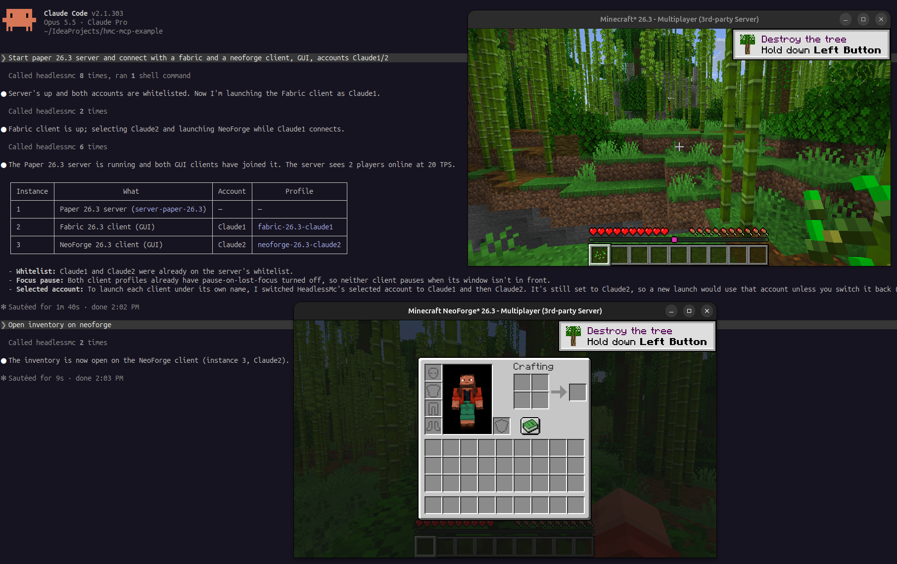

<h1 align="center" style="font-weight: normal;"><b>HeadlessMc - MCP</b></h1>
<p align="center">An <a href="https://modelcontextprotocol.io">MCP</a> server for
<a href="https://github.com/headlesshq/headlessmc">HeadlessMc</a>: install, launch and control Minecraft: Java Edition from AI agents.</p>
<p align="center"><picture>
  <source media="(prefers-color-scheme: dark)" srcset="docs/logo-dark.png">
  
</picture></p>
<p align="center"><a href="https://github.com/headlesshq/headlessmc">HMC</a> | <a href="https://github.com/headlesshq/hmc-specifics">HMC-Specifics</a> | <a href="https://github.com/headlesshq/headlessmc-skill">HMC-Skill</a></p>

> [!WARNING]
> This is a prototype. We are looking forward to feedback and feature requests.



With this MCP server, Claude Code, Codex, Cursor and other MCP clients can:

- install vanilla, Fabric, Forge and NeoForge versions, Java, and mods from Modrinth (everything HeadlessMc can do),
- launch **several** clients and servers at the same time, optionally **headless** (no display or GPU, e.g. in CI or Docker),
  each client in its own **profile** (game directory with its own mods, config and worlds),
- control running clients: read the screen, click buttons, type, chat, run commands,
  connect to servers, etc.
- read the logs of every instance and send console commands to servers.

## Setup

| Agent | Install |
|---|---|
| Claude Code | `/plugin install headlessmc-mcp --marketplace headlesshq/headlessmc-mcp` |
| OpenAI Codex | `codex plugin marketplace add headlesshq/headlessmc-mcp`, then `/plugins`, tab **HeadlessMc MCP**, **Install plugin** |
| GitHub Copilot CLI | `copilot plugin marketplace add headlesshq/headlessmc-mcp`, then `copilot plugin install headlessmc-mcp@headlessmc-mcp` |
| Cursor | clone this repository and copy `plugin` to `~/.cursor/plugins/local/headlessmc-mcp`, then **Developer: Reload Window** |
| Gemini CLI | `gemini extensions install https://github.com/headlesshq/headlessmc-mcp` |

For instructions on HeadlessMc itself (installing it, mod testing in CI with MC-Runtime-Test), install the
[headlessmc-skill](https://github.com/headlesshq/headlessmc-skill) as well.

## Tools

| Tool | Description |
|---|---|
| `hmc` | Run any HeadlessMc command line, e.g. `version install fabric 1.21.5`, `mod search sodium`, `login`. Long commands keep running, poll them with `hmc_job`. |
| `hmc_job` | Output and status of a running `hmc` command. |
| `launch_client` | Install and launch a client (version, loader or profile, headless, offline, server to join, JVM args) and wait until it shows the main menu. |
| `start_server` | Create and start a Paper/Fabric/Purpur/Forge/NeoForge/vanilla server and wait until it has loaded the world. |
| `list_profiles`, `create_profile`, `delete_profile` | Manage profiles: client setups with their own game directory. |
| `list_instances` | All launched clients and servers with their status. |
| `instance_log` | The latest lines of an instance's output, optionally filtered by a regex. |
| `server_command` | Write a console command to a server and return what it prints. |
| `stop_instance` | Quit a client or stop a server (or kill it). |
| `get_screen` | The current screen as JSON: buttons and text fields with ids, texts, positions. |
| `get_state` | JSON: in world, dead, screen, and metrics like position, health, dimension, server, ping, TPS, players. |
| `click`, `set_text`, `press_key` | Interact with the current screen. `click` returns the screen it leads to. |
| `chat` | Send a chat message or a `/command`. |
| `connect`, `disconnect` | Join or leave a server. |
| `wait_for` | Wait for `in_world`, `menu`, `screen:<Name>`, `log:<regex>` or `exit`. |
| `game_command` | Run any HMC-Specifics command inside the game (`help`, `metrics`, `render`, `respawn`, commands of other mods). |

Resource template: `hmc://instances/{id}/log`.

### Several clients at once

Every running client needs its own game directory, otherwise they overwrite each other's files and share a mods folder.
`launch_client` takes an optional `profile`: a [HeadlessMc profile](https://github.com/headlesshq/headlessmc) with its own game
directory, created in `<HeadlessMc data dir>/client/<profile>` if it does not exist. Without a profile, a client uses the default
game directory of its version, and if another client of that version is already running there, the MCP server creates a new
profile (`fabric-1.21.8-2`, ...) automatically. Versions, libraries and assets are shared between all profiles.
Agents can keep profiles for different setups and add mods to them with `mod add mod <slug> <profile>`.

### Game Control

Game control works on every Minecraft version and modloader that
[HMC-Specifics](https://github.com/headlesshq/hmc-specifics) supports (1.7.10 to 26.x, Forge, Fabric, NeoForge).
The server downloads the matching HMC-Specifics jar and puts it, together with the version independent
`hmc-mcp-bridge` mod, into the mods folder of the client before launching it.

- **The root project** (`src/`) is the MCP server, a Quarkus application. It uses HeadlessMc's CDI beans and picocli commands
  directly, like [headlessmc-web](https://github.com/headlesshq/headlessmc-web). stdout is the MCP channel, so
  HeadlessMc's console output and progress bars are captured and returned as tool results instead.
- **`hmc-mcp-bridge`** is a mod that is not tied to a Minecraft version. It uses the HMC-Specifics API and starts a small
  HTTP server on the loopback interface once HMC-Specifics has initialized. The MCP server passes it a random token and a
  port file with `-Dhmc.mcp.token` and `-Dhmc.mcp.portFile`. Without a token the mod does nothing.
  Command output comes back separately from the game log, and JSON commands make the screen and state machine-readable.

Agents can also control clients you start yourself, with any launcher (the Minecraft Launcher, Prism, MultiMC, your IDE's
run configuration, ...). Put two mods into the mods folder:

- [HMC-Specifics](https://github.com/headlesshq/hmc-specifics/releases) for your Minecraft version and modloader,
- `hmc-mcp-bridge` from the [releases](https://github.com/headlesshq/headlessmc-mcp/releases), one jar for every version and modloader.

When a game with these mods was not launched by the MCP server, the bridge creates a random token, listens on a free port of
`127.0.0.1` and registers the game in `headlessmc-mcp/instances/<pid>.json` in the user's state directory
(`$XDG_STATE_HOME`, else `~/.local/state` on Linux, `~/Library/Application Support` on macOS, `%LOCALAPPDATA%\state` on Windows).
The file is only readable by you and is deleted when the game exits. `list_instances` picks up these registrations, so the
game appears as an *attached* instance, and the game tools work as for launched clients. The log comes from `logs/latest.log`.
The MCP server never stops attached games on its own, and they have no console for `server_command`.
Launch the game with `-Dhmc.mcp.enabled=false` to turn the bridge off.

### Asking the user

Some things need the user, not the agent. The MCP server uses [elicitation](https://modelcontextprotocol.io/specification/2025-11-25/client/elicitation)
when the MCP client supports it:

- **Minecraft EULA**: `start_server` asks the user to accept the EULA with a checkbox before a server is started for the first time.
  Without elicitation support, the agent has to ask and pass `acceptEula`.
- **Microsoft login**: the `login` command asks the client to open Microsoft's device code page (URL mode), so the user signs in
  in their browser and the agent never sees credentials.
- **Prompts of HeadlessMc commands** are shown to the user as a form. Passwords and tokens are never requested,
  the MCP specification forbids that for form elicitation.
- **Deleting a profile with its files** asks for confirmation.

Long installs and launches send progress notifications, and cancelling a tool call in the client cancels the HeadlessMc command.

## Installing

Download the latest release from [GitHub Releases](https://github.com/headlesshq/headlessmc-mcp/releases):

| File | Platform |
|---|---|
| `headlessmc-mcp.jar` | Any platform with Java 25 or newer: `java -jar headlessmc-mcp.jar` |
| `headlessmc-mcp-windows-x64.exe` | Windows x64 |
| `headlessmc-mcp-linux-x64`, `headlessmc-mcp-linux-arm64` | Linux (e.g. Ubuntu) x64 and arm64 |
| `headlessmc-mcp-macos-arm64`, `headlessmc-mcp-macos-x64` | macOS on Apple silicon and Intel |

The native executables are built with GraalVM and need no Java installation for the MCP server itself
(Minecraft still needs Java, HeadlessMc can download it). On macOS, remove the quarantine flag of a downloaded executable
with `xattr -d com.apple.quarantine headlessmc-mcp-macos-*`.

## Building

Requires JDK 25. HMC-Specifics' API is not on Maven Central, it is built from the git submodule.

```sh
git clone --recurse-submodules https://github.com/headlesshq/headlessmc-mcp.git
cd headlessmc-mcp
./gradlew build
# -> build/headlessmc-mcp-<version>-runner.jar (includes the hmc-mcp-bridge mod)
# -> hmc-mcp-bridge/build/libs/hmc-mcp-bridge-<version>.jar

# native executable for the current platform, needs GraalVM 25 (or add -Dquarkus.native.container-build=true for Linux)
./scripts/build-native.sh
# -> build/headlessmc-mcp-<version>-runner
```

Releases are made with [release-please](https://github.com/googleapis/release-please) from
[Conventional Commits](https://www.conventionalcommits.org): merging its release PR creates the tag and the GitHub release,
and [the lifecycle workflow](.github/workflows/lifecycle.yml) attaches the jar and the five native executables to it.
It then publishes the npm packages (`npm/`, one package per platform with the executable, created by `scripts/npm-packages.mjs`)
and [`server.json`](server.json) to the [MCP Registry](https://registry.modelcontextprotocol.io). On the release pull request,
`scripts/sync-version.mjs` writes the new version into the npm package, the plugin manifests and `server.json`, which pin the
npm package to it.
On every other push only the Linux x64 executable is built. Dependencies are updated by [Renovate](.github/renovate.json5).

The npm package [`@headlesshq/headlessmc-mcp`](https://www.npmjs.com/package/@headlesshq/headlessmc-mcp) starts the native
executable for your platform, so with Node.js 18 or newer `npx -y @headlesshq/headlessmc-mcp@0.1.0` runs the MCP server
without downloading anything by hand. The plugins and the [setup](#setup) instructions use it.

## Configuration

| Property | Default | Description |
|---|---|---|
| `hmc.mcp.specifics.version` | `3.0.1` | HMC-Specifics release to install into clients. |
| `hmc.mcp.specifics.url` | GitHub releases | Download URL template with `{tag}`, `{mc}` and `{loader}`. |
| `hmc.files.game-for-each-version` | `true` | Separate game directory per version, so mods folders do not clash. |
| `hmc.mcp.registry` | `<state dir>/headlessmc-mcp/instances` | Where games from other launchers register, set it for the game as well. |

All HeadlessMc properties (`hmc.*`) work as well, as system properties or in HeadlessMc's config file.

The `hmc-mcp-bridge` mod reads `hmc.mcp.token`, `hmc.mcp.portFile`, `hmc.mcp.host` (`127.0.0.1`), `hmc.mcp.port` (`0`, any free port),
`hmc.mcp.registry` and `hmc.mcp.enabled` (`true`) from system properties. Without `hmc.mcp.token` it registers the game for attaching.

## Status and limitations

Tested end to end with headless Fabric 1.21.8 clients: launch, main menu, singleplayer world creation, chat command, metrics, quit,
two clients of the same version at once (the second one in an automatically created profile), elicitation for prompts, EULA and login,
attaching a second MCP server to a client that was launched without it.
Not tested yet: running servers, Forge/NeoForge, legacy versions.

- Screens are identified by class name, which is obfuscated in production Fabric/Forge environments (e.g. `class_442`
  is the title screen). Button texts are readable, so agents navigate by those.
- Vanilla clients can not be controlled, HMC-Specifics needs a modloader.
- Without elicitation support in the MCP client, HeadlessMc prompts fail, pass all arguments to commands.
- No screenshots in headless mode, the game does not render.

## Privacy and terms

The MCP server runs locally and sends no telemetry. See the [Privacy Policy](PRIVACY.md) and the [Terms of Use](TERMS.md).
HeadlessMc - MCP is not an official Minecraft product and is not approved by or associated with Mojang or Microsoft.
